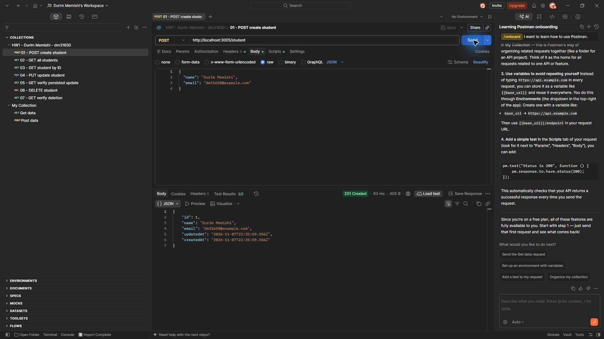
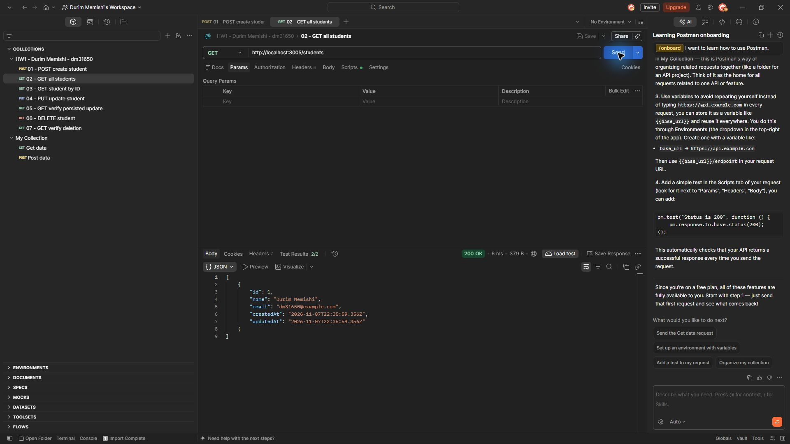
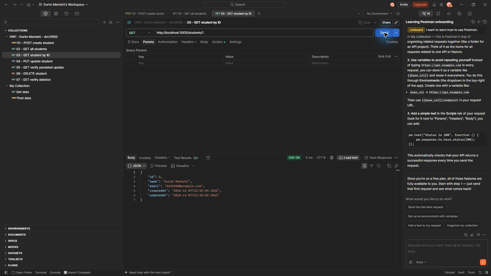
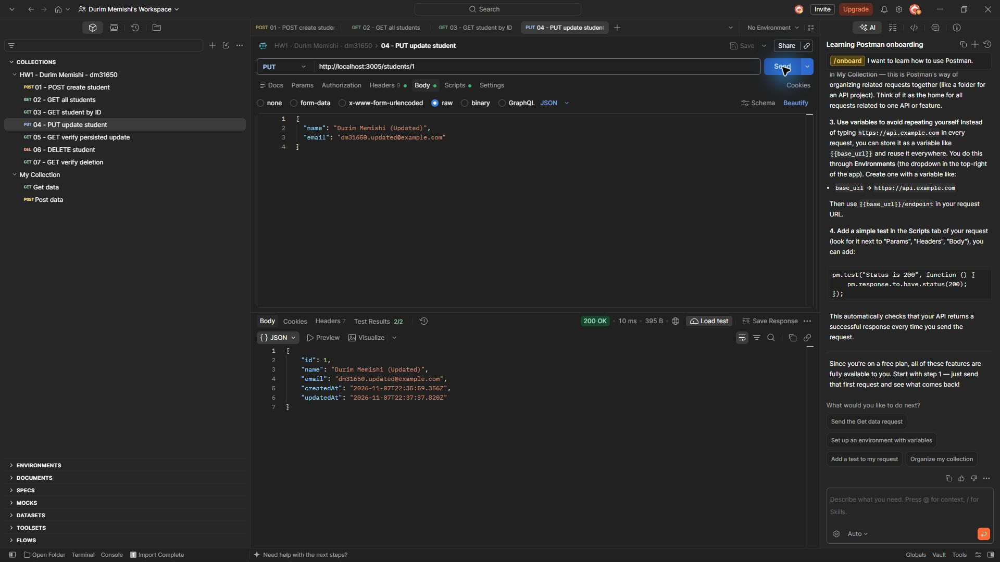
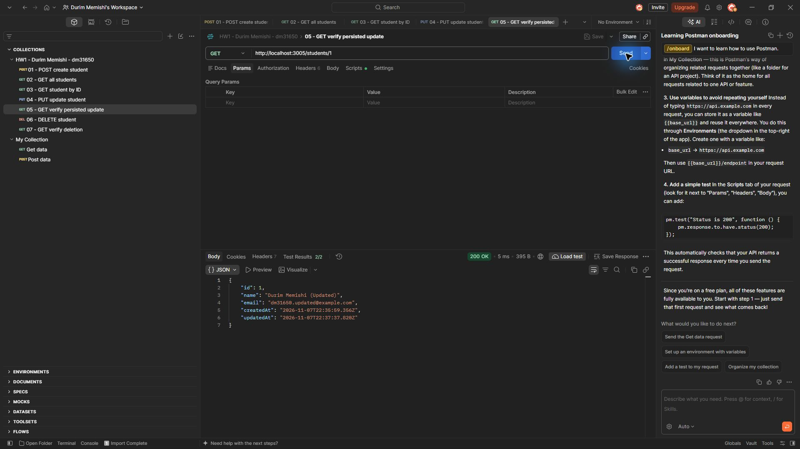
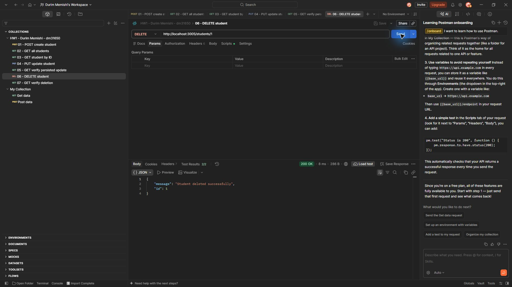
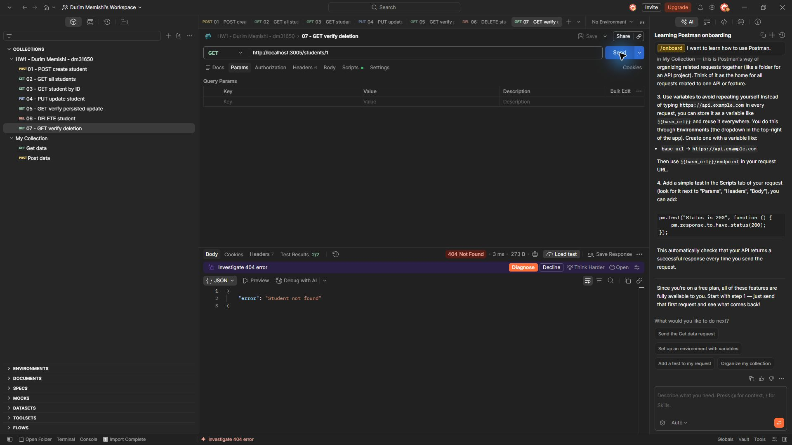

# Postman evidence - Durim Memishi (dm31650)

These are unedited screenshots captured from the official Postman desktop application while sending requests to this project's running API at `http://localhost:3005`.

The requests were run in the collection order below. Each screenshot shows the HTTP method, full URL, response status, response JSON, and **2/2** passing Postman tests.

1. **POST /student - 201 Created**: created Durim Memishi with ID 1.  
   
2. **GET /students - 200 OK**: returned the new student in the list.  
   
3. **GET /students/1 - 200 OK**: returned the saved student.  
   
4. **PUT /students/1 - 200 OK**: changed the name to `Durim Memishi (Updated)` and email to `dm31650.updated@example.com`.  
   
5. **GET /students/1 - 200 OK**: independently retrieved the updated values.  
   
6. **DELETE /students/1 - 200 OK**: confirmed successful removal of ID 1.  
   
7. **GET /students/1 - 404 Not Found**: confirmed the deleted student no longer exists. This is the expected successful outcome of the verification request.  
   

## Direct database verification

In addition to the Postman verification requests, the live `students.sqlite` file was opened through a separate SQLite connection:

- After PUT, `SELECT id, name, email FROM Students` returned `(1, 'Durim Memishi (Updated)', 'dm31650.updated@example.com')`.
- After DELETE, `SELECT COUNT(*) FROM Students` returned `0`.

Automated tests also verify update and deletion persistence in an isolated SQLite file. Run `npm test` from the project directory; the recorded run passed all 13 tests with zero failures.

The sample `example.com` addresses are test data. Generated databases and installed dependencies are excluded from the commit.
